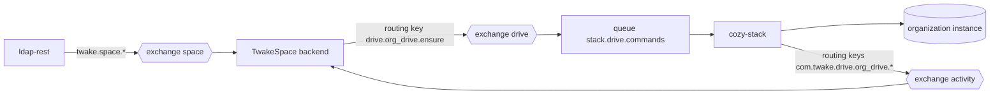
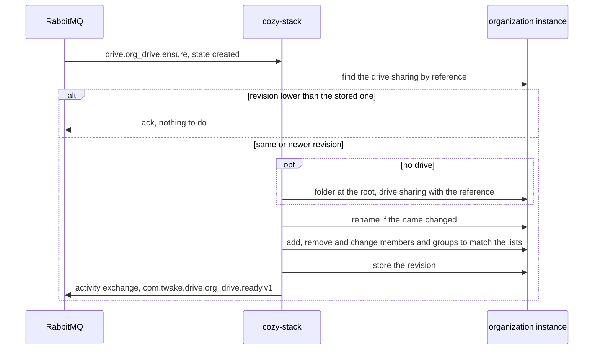
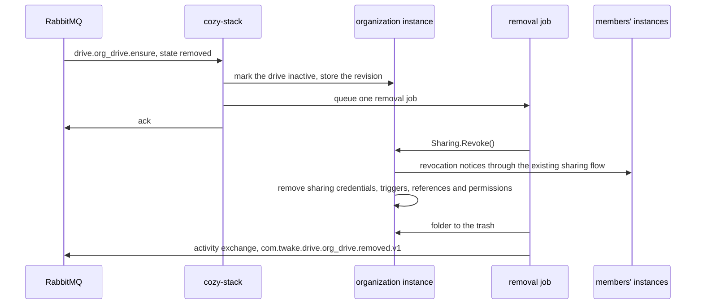

# ADR: Organization drives provisioned by other apps

## Status

Proposed

## Date

2026-10-12

## Context

We want other apps to get shared drives on the organization instance, kept in sync with their own objects: created, renamed, members added and removed, deleted. TwakeSpace is the first, with one drive per space.

These apps have no token for the organization instance, so they ask over RabbitMQ. The stack should do this without knowing what a space is, so the next app needs no new code in the stack.

## Decision

- The stack consumes one command, `drive.org_drive.ensure`, that states what a drive should look like: its name, its members and groups with their rights, and whether it exists at all. It knows nothing about the app sending it.
- The app names the drive with a `reference` (`source` and `id`). The stack stores it on the drive sharing and finds the drive by it, so the same command can be sent any number of times.
- Each command carries a `revision`. The stack ignores a command whose revision is lower than the one it last applied, and applies one with the same revision again, so a redelivery after a failure finishes the work.
- After applying a command, the stack replies on the `activity` exchange with the reference and the drive id. The app maps the reference back to its own object.
- Removal is the same command with `state: removed`. The stack cuts access in one write, then revokes members and cleans up in a background job, in pages.
- Only the app's commands delete, move or rename its drives. The stack refuses these API calls on a drive that has a reference, whoever makes them.
- TwakeSpace sends the command from the space events it already consumes. The stack does not consume space events.
- For Drive, this replaces what [ADR 005](https://github.com/linagora/twake-space-architecture/blob/d8b85ecbe0cfffba446a410ab999e49ba949d621/ADR005.md) asks of each app: consuming the space events, the `twake.space.synced` reconciliation and `com.twake.drive.space.provisioned.v1`. There is no activity on a drive before its reply is confirmed. Removed folders use the stack's normal per-context trash-retention policy.

### Architecture



`drive` is a topic exchange declared by the deployment, like `b2b` and `platform`. The stack declares `stack.drive.commands` with its dead letter exchange and queue, as for the other command queues.

### The command

Routing key `drive.org_drive.ensure` on the `drive` exchange:

```json
{
  "organizationId": "org123",
  "reference": { "source": "twake-space", "id": "3b9e2c71-5d4a-4f0e-9c8b-1a2d6e7f8091" },
  "revision": 42,
  "state": "created",
  "name": "Product launch",
  "members": [
    { "email": "alice@example.com", "role": "write" },
    { "email": "bob@example.com", "role": "read" }
  ],
  "groups": [
    { "id": "engineering", "role": "read" }
  ],
  "activity": true
}
```

- `organizationId`: the organization. The drive lives on its organization instance, the instance whose slug is the organization id.
- `reference`: required. `source` names the app, `id` is the app's own id. The pair is unique per organization.
- `revision`: required, a positive number that increases for each reference. It is a counter the app keeps per reference, not a timestamp. Clocks differ between machines, and with events out of order, the time of the event behind a command can be lower than a revision already applied, so the stack would drop the command and its change.
- `state`: `created` or `removed`.
- `name`: required when `state` is `created`.
- `members`, `groups`: optional, `role` is `read` or `write`. Together they are the complete list: a member or group on the drive that is in neither is removed.
- `groups[].id`: the organization's group id, as `b2b.group.*` events carry it.
- `activity`: optional, turns on the activity digest of [ADR 010](010-adr-drive-activity-digest.md).

### Applying a `created` command



- The folder is named after `name`, with a suffix such as "Name (2)" when the name is taken. A rename follows the same rule.
- Members are looked up by email in the organization directory of the organization instance. Adding them writes the sharing document a fixed number of times, whatever their number.
- Groups are looked up among the organization's groups the stack already replicates from `b2b.group.*`. The drive is shared with the group, so people joining or leaving the group join or leave the drive without a new command, as for any group sharing.
- A member or group that cannot be added (unknown email or group, several matches) is skipped. The others still get the drive, and the reply lists the skipped ones.
- Members can't change who is on the drive from the Drive app: the next command would undo it. Their right to create links and invitations stays under the drive's sharing policy ([ADR 003](003-adr-org-drive-sharing-policy.md)).
- If the drive was lost all the same (its sharing or its folder removed by an operator), the command creates a new drive, and the reply carries its new id.

### Locked drives

A drive with a reference belongs to the app that sent it. The stack answers 403 to:

- trash, delete, move or rename its root folder, through `/files` on the organization instance or `/sharings/drives/:id` for a member
- change the description of its sharing, or revoke the whole sharing, through `/sharings/:id`

The files and folders inside the drive stay editable, under each member's rights.

The stack sets the reference only from a command. It drops a `reference` sent to `POST /sharings` or `PUT /sharings/:id`, and `/data` already refuses `io.cozy.sharings`.

Without the lock, trashing the root folder revokes the sharing and deletes its document, so the stored revision goes with it and a late command creates the drive again. A rename would only last until the next command.

### Applying a `removed` command



- Revoking a drive sharing in one call costs one HTTP call and one full sharing write per member, then one update per shared file. For a large drive that does not fit in a delivery, hence the job.
- Marking the drive inactive cuts every member's access at once, because the drive routes refuse an inactive sharing, also when the organization and the member are on the same stack. The handler does nothing else, so it finishes quickly whatever the size of the drive.
- The job uses the existing `Sharing.Revoke()` method. Each revoked member is saved by that method, so a retry skips members already revoked. There is no separate revocation or batching implementation for provisioned drives.
- The folder goes to the trash through `vfs.TrashDir`. Cleanup is scheduled with the same helper as HTTP trash, using `clean-old-trashed` and the context setting `fs.auto_clean_trashed_after`. Without that setting, there is no automatic purge. There is no separate purge timer for these drives.
- When a whole organization goes, each drive is its own command and its own job. The queue prefetch and the job workers cap how much runs at once.
- A later `created` command with a higher revision creates a new drive. It does not restore the trashed folder.

### Replies

Both replies are CloudEvents on the `activity` exchange, published by the stack with `source` `twake://drive`.

`com.twake.drive.org_drive.ready.v1`, after every applied `created` command:

```json
{
  "specversion": "1.0",
  "id": "0199c1a2-7b3d-7e9a-8f61-2d5b9c0e4a17",
  "source": "twake://drive",
  "type": "com.twake.drive.org_drive.ready.v1",
  "time": "2026-10-12T09:15:03Z",
  "twakeorg": "org123",
  "data": {
    "reference": { "source": "twake-space", "id": "3b9e2c71-5d4a-4f0e-9c8b-1a2d6e7f8091" },
    "revision": 42,
    "drive": { "id": "a1f0c3e2d4b5" },
    "skipped": [{ "email": "carol@example.com", "reason": "not in the organization directory" }]
  }
}
```

`com.twake.drive.org_drive.removed.v1`, when the removal job ends, with only `reference` and `revision` in `data`.

`drive.id` is the id of the drive sharing, the same on the organization instance and on every member's instance.

The stack publishes the replies with publisher confirms, and stores on the sharing that `ready` was confirmed. The activity of a drive ([ADR 010](010-adr-drive-activity-digest.md)) is dropped until then, so TwakeSpace always knows the drive before its first activity.

### Failures

- Malformed command, or unknown `state` or `role`: sent to the dead letter queue at once.
- No organization instance, or CouchDB unavailable: the message is redelivered up to the queue's `delivery_limit`, then dead-lettered.
- A crash after the drive was created but before the reply: the redelivery finds the drive by its reference, so no second drive is created.
- Commands out of order: the revision check drops the older one, once the reference has a drive (see the open questions for a `removed` that comes first).
- Replies are published after the work is saved. A failed publish fails the delivery, and the redelivery publishes the same reply again. The app must accept a reply twice.

### What TwakeSpace needs to do

- Publish `drive.org_drive.ensure` with the space's full state after each space event it handles (created, updated, member and group changes, deleted), once its own transaction is committed.
- On `twake.space.synced`, send `ensure` for the space, and on `twake.space.sync.completed`, send `state: removed` for the drives of the spaces that are not listed.
- Keep a revision per space in a row that is never deleted, increment it in the transaction that applies each change to the space, and send the new value as `revision`, for `removed` too. The row lock makes the handlers of one space take turns, so a higher revision always carries a newer state.
- Map `viewer` to `read`, and `editor` and `admin` to `write`.
- Consume `com.twake.drive.org_drive.ready.v1` and `removed.v1`, and map `reference.id` back to the space.

## Consequences

- No app-specific code in the stack. A new app gets drives by choosing a `reference.source`.
- Renames, member changes and removal come from the same command, and redeliveries and reordering are safe, apart from the `removed` that comes first in the open questions.
- Removing a large drive does not block a delivery, and its cost is spread over a job.
- The app is the source of truth for who is on the drive. Members and groups added or removed from the Drive app are overwritten by the next command.
- Apps depend on the stack's reply to learn the drive id, and must handle duplicates.

## Open questions

- Is the group id TwakeSpace receives with `twake.space.group.linked` the same id `b2b.group.*` events carry?
- A person can be both a member and in a group with another role. Which role wins, the higher one?
- A `removed` command for a reference that has no drive yet stores nothing, so a `created` with a lower revision that arrives after it creates the drive. Should the stack keep the last revision and state of each reference in a document of its own, never deleted? Its id, derived from the reference, would also stop two stacks from applying commands for the same reference at once.
- Should the command also carry the drive's sharing policy ([ADR 003](003-adr-org-drive-sharing-policy.md)), or does the organization admin set it from the Drive app?
